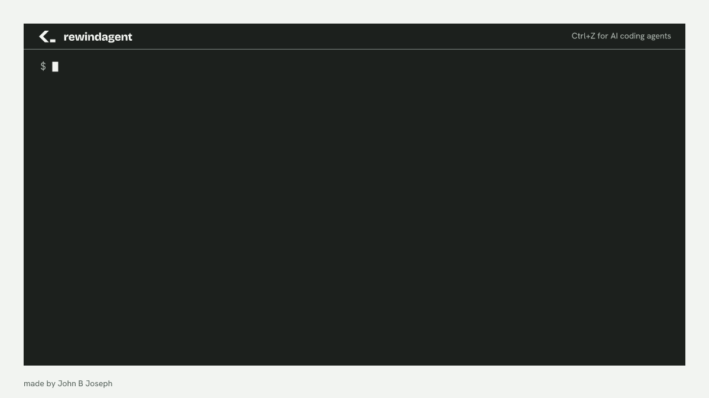

# rewindagents

<picture>
  <source media="(prefers-color-scheme: dark)" srcset="brand/logo-wordmark-reverse.svg">
  
</picture>

rewindagents rewinds what your coding agent changed, step by step, from one verifiable log, including the files
only a shell command touched.

Claude Code's own [checkpointing docs](https://code.claude.com/docs/en/checkpointing) (read 2026-11-12) name
that gap: "A file that only Bash commands changed isn't tracked and stays as it is." (its `/rewind` does undo Bash
changes to a file Claude had already edited), and, of subagents, "Claude Code usually doesn't capture those edits
in your session's checkpoints." rewindagents copies the project's files before every shell command and scans
them after, so a `sed -i` or an `rm` is one more step you can rewind. Claude Code runs the same hooks for a
subagent's tool calls ([hooks docs](https://code.claude.com/docs/en/hooks)), so those go into the same log;
`tests/test_subagent.py` drives the hook with payloads shaped the way that page describes and rewinds them, but
no live subagent session has been recorded yet. Every tool call goes into a tamper-evident, hash-chained log you
can verify later.

**Status: v0.0.7, pre-release.** Built and tested today: the recorder and its CLI, hooks for seven coding
agents (Claude Code, Codex, Cursor, Gemini CLI, Copilot CLI, Droid, Qwen Code) that record every call and checkpoint the files a step changes, `replay`, `rewind` and
`branch`, `export` (a session as one HTML page), `sessions` (list and search the sessions in a log),
`bundle` and `import` (carry a session to another machine or clone as one file), `gc` (delete stored file
copies nothing names any more), and a pip-installable package with a `rewindagents` command. Not on PyPI yet. The Claude Code hook has run in real
sessions; the Codex and Cursor hooks are built from the vendors' hook documentation and tested with the
documented payloads, not yet in a live session.



The clip is a real session, not a mock-up: `brand/demo/build.py` runs fourteen agent steps through the
hook in a temporary project, then the four commands shown, and draws the frames from what they printed.
`tests/test_demo.py` plays the same session again and fails if any line differs.

## Quick start

The flight recorder for coding agents: see exactly what your agent did, and take back any part of it.

```sh
pipx install git+https://github.com/Johnbjoseph-cybersec/rewindagents && cd your-project && rewindagents init
```

`init` looks for the agents it supports (Claude Code, Codex, Cursor, Gemini CLI, Copilot CLI, Droid, Qwen
Code): their config directory in the project or your home directory, or their command on `PATH`. It prints
the plan, asks `[y/N]`, and adds the hook to each one it found, one line per agent: `installed`,
`already there`, `replaced` or `not found`. It never adds a second copy and keeps every hook already in the
file.
`--yes` skips the question. `--global` writes each agent's user config instead, so every project is
recorded. Without `--yes` and without a terminal to ask on, it only prints the plan.

Then use your agent as usual and:

```sh
rewindagents replay                    # what it did, one line per step
rewindagents diff 12                   # what taking it back to step 12 would change
rewindagents rewind 12 --only src/db.py   # take back just that file
```

## Install

Python 3.10 or newer (declared in `pyproject.toml`; tested on 3.15, macOS). No dependencies beyond the
standard library. From the repository:

```sh
pipx install git+https://github.com/Johnbjoseph-cybersec/rewindagents     # or: pip install git+https://...
rewindagents --version
```

Or from a clone, `pip install .`. Without installing, `PYTHONPATH=src python3 -m rewindagents` runs the same
CLI from a clone.

After the first release to PyPI (not there yet), `uv tool install rewindagents` or `pipx install rewindagents`
will also work. Do not add the hook with `uvx rewindagents install` or `pipx run rewindagents install`: those run
from a cached environment the tool may delete, and the hook names that environment's Python. `install` and
`init` detect such a Python, write nothing, and print the two lasting commands above.

## Claude Code hook

```sh
cd /path/to/your/project
rewindagents install            # adds the hook to .claude/settings.json in this project
rewindagents install --settings ~/.claude/settings.json   # or for every project
```

`install` keeps everything already in the settings file and does nothing if the hook is already there. The
hook command it writes names the Python that rewindagents was installed into by absolute path, so it runs
whether or not a virtualenv is active; from an uninstalled clone it carries the `PYTHONPATH` instead.

If that Python goes away later (the venv is deleted, Python is upgraded, the clone is moved), the agent still
runs the hook, the hook fails, and nothing is recorded. `status` checks for that:

```sh
rewindagents status             # per agent config file: ok, STALE, partial or no hook; then the log: records, last write, chain
```

A hook is stale when its interpreter path or its `PYTHONPATH` directory no longer exists; `status` then exits
1. `install` and `init --yes` replace a stale rewindagents hook with the current one and leave every other
hook in the file as it is.

The last line of `status` is this project's log: how many records it holds, when the last one was written,
and whether the chain verifies. A hook that is in place while the log stays empty after the agent has made a
tool call is failing for a reason the stale check cannot see (a broken install, for example); `status` says so.
A log that does not verify makes `status` exit 1, as `verify` does. `status` writes nothing.

Once the hook is in, in each project Claude Code works in:

- every tool call gets a `pre` record (tool and input) and a `post` record (tool and response) in
  `.rewindagents/log.jsonl`, in one hash chain. Responses longer than 4,000 characters are cut, with the
  full length noted. So is any text in the input longer than 4,000 characters (a `Write`'s content, an
  `Edit`'s new text): every key stays, and the file path and the command are kept whole. Rewind does not
  need that text; it restores from the copies below. `bench/log_growth.py` writes one 10 MB file through
  the real hook: before this cut the log grew by 20,972,561 bytes, now by 9,135.
- before `Write`, `Edit`, `MultiEdit` and `NotebookEdit`, the current bytes of the target file are copied
  to `.rewindagents/objects/<sha256>` and the hash goes into the `pre` record. A file that does not exist
  yet is recorded as absent. Files over 20 MB are noted and not copied.
- `.rewindagents/` gets its own `.gitignore`, so the log and the copies stay out of your commits.

The hook never blocks or changes a call. It prints nothing and always exits 0, even if its input is
broken or it cannot write; any problem goes to stderr only. `tests/test_hook_hardening.py` runs the real
hook process for all seven agents on empty, cut-off and non-object input, fields of the wrong type, bytes that
are not UTF-8, a 10 MB tool response, a `cwd` that does not exist and a post with no pre: each exits 0, prints
only that agent's reply, and leaves the log verifying. What it can read it records (bad text as U+FFFD, the
response cut to its first 4,000 characters); for a `cwd` that does not exist it records nothing and creates
nothing.

Around every `Bash` call (for example `sed -i`, `rm`, `mv`, a code generator), the hook saves the
project's files before the command, scans again after it, and checkpoints, in the `post` record, only the
files that were changed, deleted or created. Details and limits:

- "The project's files" means, in a git repo, what `git ls-files --cached --others --exclude-standard`
  lists: tracked and untracked files, but not git-ignored ones. Outside git, every file under the project
  directory except `.git`, `.rewindagents`, `node_modules`, `.venv`, `venv` and `__pycache__`.
- Only the project directory is scanned. A command that changes files elsewhere is recorded, not saved.
- Symlinks are not saved. Files over 20 MB are noted and not copied.
- Copies are stored by SHA-256, so an unchanged file is stored once. A stat cache
  (`.rewindagents/index.json`) means only files whose size or modification time changed are read again.
- A project with more than 20,000 files is not scanned; the call is still recorded and `rewind` reports it.
- A Bash call with `run_in_background: true`: Claude Code's hooks reference documents no hook event for a
  background shell finishing, so the after-scan may run while the command is still going. Files it changes
  after that are not in the step. `replay` marks such a step `[background: scan may be early]`, and `rewind`
  and `diff` print a note and exit 1 when one lies after the target step.

To take the hook out again:

```sh
rewindagents uninstall          # removes the hook from .claude/settings.json in this project
rewindagents uninstall --agent cursor --settings ~/.cursor/hooks.json   # same flags as install
```

`uninstall` removes only the entries whose command is exactly the one `install` writes from the same Python,
so every other hook and setting stays. If the file holds none, it is not rewritten and says so. It never
touches `.rewindagents/`: sessions already recorded can still be replayed and rewound.

## Overhead

<!-- overhead:start -->
Measured by `bench/hook_overhead.py` on macOS 27.0.1, Apple M6, 12 CPUs, Python 3.15.0, on 2026-11-12 (commit b11b369, load average 22.2 at the start). Time the hook adds to one tool call: both hook processes (before and after the call), median of 15 calls with the 90th percentile in brackets. Each hook event is a new Python process; starting one and importing the package alone takes 108 ms (median), and every call starts two. Raw numbers: `bench/results.json`.

| Project files | Read | Edit | Bash | First Bash (empty store) |
|---:|---:|---:|---:|---:|
| 100 | 228 ms (273 ms) | 210 ms (281 ms) | 281 ms (438 ms) | 410 ms |
| 1,000 | 224 ms (241 ms) | 220 ms (277 ms) | 351 ms (495 ms) | 605 ms |
| 10,000 | 226 ms (292 ms) | 223 ms (351 ms) | 1,003 ms (1,180 ms) | 4,554 ms |

Other machines, disks and projects will differ; run `python3 bench/hook_overhead.py` to measure yours.
<!-- overhead:end -->

## Codex and Cursor hooks

```sh
rewindagents install --agent codex      # adds the hook to .codex/hooks.json in this project
rewindagents install --agent cursor     # adds the hook to .cursor/hooks.json in this project
rewindagents install --agent cursor --settings ~/.cursor/hooks.json   # or for every project
```

Same recorder, same log, same `replay`, `rewind`, `branch`, `export` and `sessions`. What differs is how each
agent calls the hook, and `src/rewindagents/agents.py` quotes the vendor documentation (read 2026-11-11) it was
built from:

- Codex (`.codex/hooks.json`, the same file shape as Claude Code's settings) sends `PreToolUse` and
  `PostToolUse` with `session_id`, `cwd`, `tool_name`, `tool_use_id`, `tool_input` and `tool_response`; shell
  commands arrive as `Bash` and file edits as `apply_patch`. Codex asks you to trust a new hook before it runs
  (`/hooks` inside Codex) and remembers the trust by the hook's hash, so a hook command that changes needs
  trusting again. Project hooks load only when the project's `.codex/` folder is trusted.
- Cursor (`.cursor/hooks.json`) sends `preToolUse` and `postToolUse` with `conversation_id` (used as the
  session), `cwd`, `tool_name`, `tool_input`, `tool_use_id` and, after the call, `tool_output`; its tools are
  `Shell`, `Read`, `Write`, `Grep`, `Delete`, `Task` and `MCP:<name>`. Cursor's `preToolUse` is a permission
  hook that treats an empty or invalid answer as a failure, so for Cursor the hook prints
  `{"permission": "allow"}` before a call and `{}` after one. "allow" is the one answer that changes nothing;
  a deny from any other hook still wins.
- The input of Codex's `apply_patch` and Cursor's `Write` is not documented, so the hook never reads a file
  path out of a Codex or Cursor payload. Instead, around every Codex or Cursor call except the tools the docs
  name that cannot change files (Cursor's `Read` and `Grep`, Codex's `update_plan`), the project is saved
  before the call and scanned after it, exactly as around a `Bash` command, and only the files the call
  changed, created or deleted are checkpointed. The cost is a stat of every project file per call; unchanged
  files are not read again. The same 20 MB and 20,000-file limits apply.
- Verified so far: the hook driven by the payloads in the vendors' documentation, in `tests/test_agents.py`
  and through the installed binary in `tests/test_installed.py`. Not yet in a live Codex or Cursor session.
  If a real session sends something else, open an issue with the payload (`replay --step N` prints what
  was recorded).

## Gemini CLI, Copilot CLI, Droid and Qwen Code hooks

```sh
rewindagents install --agent gemini     # adds the hook to .gemini/settings.json in this project
rewindagents install --agent copilot    # adds the hook to .github/hooks/rewindagents.json in this repository
rewindagents install --agent droid      # adds the hook to .factory/settings.json (or .factory/hooks.json if it exists)
rewindagents install --agent qwen       # adds the hook to .qwen/settings.json in this project
rewindagents uninstall --agent qwen     # same flags as install, for every agent
```

These are built from the vendors' hook documentation (read 2026-11-12, quoted with URLs in
`src/rewindagents/agents.py`) and tested with the documented payloads, not yet in a live session of any of
them. As for Codex and Cursor, the hook never reads a file path out of these payloads: the project is saved
before every call and scanned after it, except around the tools each agent's docs name as read-only, which
are recorded but not scanned.

- Gemini CLI (`.gemini/settings.json`) sends `BeforeTool` and `AfterTool` with `session_id`, `cwd`,
  `tool_name`, `tool_input` and, after the call, `tool_response`. Shell commands arrive as
  `run_shell_command`, edits as `write_file` and `replace`. Gemini reads the hook's stdout as JSON, so the hook
  prints `{}` (no decision, which changes nothing). Not scanned: `read_file`, `read_many_files`,
  `list_directory`, `glob`, `grep_search`, `search_file_content`, `google_web_search`, `web_fetch`.
- GitHub Copilot CLI (`.github/hooks/rewindagents.json`): installed under the PascalCase events `PreToolUse`,
  `PostToolUse` and `PostToolUseFailure`, which select the payload with `hook_event_name`, `session_id`, `cwd`,
  `tool_name`, `tool_input` and `tool_result` (or `error` for a failed call). Tools: `bash`, `create`, `edit`.
  The hook prints nothing. Copilot's `preToolUse` is fail-closed: a non-zero exit denies the call. So the
  command it writes ends in `|| true`, and even a missing Python exits 0. In Copilot's cloud agent the hook
  file is read from the default branch, and this machine's Python is not there, so nothing is recorded and
  nothing is blocked. Not scanned: `view`, `grep`, `glob`, `web_fetch`.
- Factory Droid sends `PreToolUse` and `PostToolUse` with `session_id`, `cwd`, `tool_name`, `tool_input` and
  `tool_response`. Tools: `Execute`, `Create`, `Edit`, `ApplyPatch`. Droid reads the `hooks` key of
  `.factory/settings.json` only when `.factory/hooks.json` is absent, so the hook goes into `.factory/hooks.json`
  when that file exists and into `.factory/settings.json` otherwise. A new `hooks.json` would hide hooks you
  keep in `settings.json`. The hook prints nothing. Not scanned: `Read`, `LS`, `Glob`, `Grep`, `FetchUrl`,
  `WebSearch`.
- Qwen Code (`.qwen/settings.json`) sends `PreToolUse`, `PostToolUse` (a call that succeeded) and
  `PostToolUseFailure` (one that failed), with `session_id`, `cwd`, `tool_name`, `tool_use_id`, `tool_input`
  and `tool_response` or `error`. A failed shell command can still have changed files, so the hook is installed
  on `PostToolUseFailure` too and closes the scan there. The hook prints nothing. Not scanned: `read_file`,
  `list_directory`, `glob`, `grep_search`.
- Gemini CLI, Copilot CLI and Droid send no call id, so a call's before and after events are paired by
  session and input. Two identical calls running at the same moment in one session would share a scan.
- Not supported yet, and why: Windsurf's hooks page now leads to Devin's, and Devin's payload documents no
  working directory. Devin also runs hooks from `.claude/settings.json` by default, so a Claude Code install
  fires there as the Claude Code hook, and it never blocks. Kiro documents the payload before a call but not
  after one. Cline, OpenCode and Amp hooks are JavaScript/TypeScript plugins, not commands. Roo Code, Zed,
  Warp and Replit document no tool hooks.

## Timeline UI

```sh
rewindagents ui                      # opens the timeline in your browser; Ctrl+C stops it
rewindagents ui --session abc --no-open --port 8765
```

A local page over the log. Sessions on the left. In the middle, the session as a timeline: each step's
number, tool, agent, file or command, time, the files it changed with +/- line counts, its checkpoints,
rewind steps, and the steps a later rewind undid. Click a step, or move with `j` / `k`, to see each file's
diff and the step's input and result (`d` hides or shows the diffs).

- **Preview rewind to here** shows the files `rewind N` would put back or delete, each as a diff from now,
  using the same plan as `diff N`. It changes nothing.
- **Rewind to here** (or `r`) asks first, then runs the same rewind as `rewindagents rewind N`: the hash
  chain is checked, the rewind is recorded as a new step, and an Undo button rewinds it back.
  **Rewind just this file** does the same as `rewind N --only PATH`.
- It listens on 127.0.0.1 only, on a free port unless you pass `--port`. The link it prints carries a
  random token made for this run; every request without it gets a 403, and so does any request whose
  Host header is not 127.0.0.1 or localhost on that port. Rewinds are POST only and must come from the
  page itself. No fonts, scripts or images are fetched from anywhere, so it works offline.
- Diffs are cut as `export` cuts them (400 lines per file, files over 256 KB described). An input or
  result longer than 20,000 characters is cut on the page, with the count left out.

## Replay, rewind, branch

Run these from the project directory (the one holding `.rewindagents/`). They work on the latest session
unless you pass `--session ID`.

```sh
rewindagents replay              # one line per step: number, tool, file or command
rewindagents replay --step 12    # step 12 in full: input, checkpoints, result
rewindagents rewind 12 --dry-run # what would change
rewindagents diff 12             # the same files, as a unified diff: now -> step 12
rewindagents diff 12 src/db.py   # only that file (a directory means every file under it)
rewindagents rewind 12           # files back to how they were right after step 12
rewindagents rewind 12 --only src/db.py --only tests/   # put back only these
rewindagents branch 12 --name try2   # keep the current files, then rewind to step 12
```

- `diff N [PATH ...]` reads the same plan `rewind N` acts on, so it names exactly the files `rewind N
  --dry-run` lists (a test checks this). The `a/` side is the file now, the `b/` side is the file after the
  rewind, so `git apply` of the diff does what the rewind would do. Files the rewind would delete diff to
  `/dev/null`; binary files are named, not printed; files it cannot put back are listed on stderr. It
  writes nothing. Exit code 1 when something could not be shown, as for `rewind`.
- `rewind N --only PATH` puts back only those files (or every file under a directory) and leaves the
  agent's other changes as they are. Same hash-chain and stored-copy checks, and it is recorded as a step
  like any rewind, so it can be undone. A path no step after N changed is reported as `skip`; if none of
  the paths was changed, nothing is written and the exit code is 1.

- `rewind N` puts back every file that a step after N changed with `Write`, `Edit`, `MultiEdit`,
  `NotebookEdit` or a `Bash` command, and deletes the files those steps created. `rewind 0` undoes the
  whole session.
- A rewind is undoable. It first saves the current bytes of every file it will change and records itself
  as a new step; the command prints `undo it with: rewindagents rewind <step> --session <id>` (from an
  uninstalled clone it says `python3 -m rewindagents` instead).
- `branch N --name X` does the same and, in a git repo, also commits the whole current working tree to the
  branch `rewindagents/X`. It does this through a temporary index, so your `HEAD`, index and current
  branch stay as they were. Outside git, the current files are kept in the log only.
- Before writing anything, rewind checks the log's hash chain and the SHA-256 of every stored copy. If the
  chain is broken it changes nothing. If a stored copy no longer matches, that file is reported and left
  as it is.
- It only touches files inside the project directory. Files outside it are reported and left alone.
- Limits: a step whose before/after scan did not finish (a `Bash`, `Shell` or `apply_patch` call in a project
  of more than 20,000 files, or one whose post event never arrived) is counted and reported, and its changes
  are not put back. Directories created by
  later steps stay (empty). Files over 20 MB were never copied, so they are reported and not restored. If
  anything could not be restored, the exit code is 1.

## Export a replay

```sh
rewindagents export                                  # writes .rewindagents/replay-<session>.html
rewindagents export --session abc --out replay.html  # a given session, to a given file
rewindagents export --no-contents                    # steps, tools and paths only: no inputs, results or diffs
rewindagents export --no-redact                      # keep secrets as recorded (they are replaced by default)
```

One HTML file with the whole session: every step with its tool, input and result, and for every file a
step checkpointed, the change that step made as a unified diff (the file before the step against the file
after it: its next checkpoint in the session, or the file as it is now). Open it in a browser, attach it to a
bug report or a code review, or keep it with the session.

- Inline CSS only. No scripts, and nothing is fetched from anywhere, so the page is safe to pass on.
- Paths inside the project are shown relative to it; where the project lives on disk is not in the page.
- A file over 256 KB on either side is described, not diffed. A diff longer than 400 lines is cut, with
  the count of the lines left out. Binary files show their size before and after.
- Inputs and results are the recorded ones, so a result that was cut at 4,000 characters stays cut.
- `--no-contents` drops inputs, results and diffs (a `Write` input is the file's content). Each step keeps
  the one-line summary `replay` prints, so a `Bash` command line is still on the page.
- If the log's hash chain does not verify, the page is still written, with a notice naming the first bad
  record, and the command exits 1.
- Secrets are replaced with `[redacted <kind>]` in every input, result, diff and step line, and the page
  says how many: AWS access key ids, GitHub, Polar, OpenAI and Anthropic tokens, webhook secrets
  (`whsec_`), private key blocks, the credential in an `Authorization` header, the value of anything named
  like a secret (`..._TOKEN`, `PASSWORD`, `API_KEY`, `client_secret`), and every value in a `.env` or
  `.env.*` file. It is pattern matching: a secret of another shape stays, so read the page before you pass
  it on. A file whose change was only inside a replaced value says so. `--no-redact` turns this off.

## Find a session

```sh
rewindagents sessions                     # every session in the log: id, first and last time, steps, files touched
rewindagents sessions --grep config.py    # only sessions with a step that mentions it, and those steps
```

One line per session, in the order the sessions first wrote to the log, with the session id, the local
time of its first and last record, the number of steps (the numbers `replay` and `rewind` use, with how
many of them are rewinds or branches) and the files it touched; a second line names the first 5 files and
counts the rest. The session that wrote the
last record, the one `replay` and `rewind` use by default, is marked `(latest)`.

- A file is touched when a step checkpointed it: changed, created or deleted by `Write`, `Edit`,
  `MultiEdit`, `NotebookEdit`, a `Bash` command or a rewind. A file that was only read is not touched.
- `--grep TEXT` keeps the sessions with a step whose `replay` line (the command, the file, or the
  input) or checkpointed path contains TEXT, in any case, and lists those steps under the session with
  their step numbers, so `rewindagents rewind <step> --session <id>` can follow. Exit code 1 if no session
  matches.
- Paths are shown relative to the project.

## Move a session to another machine

```sh
rewindagents bundle --out s1.bundle                 # the latest session, and the file copies it names, in one file
rewindagents bundle --session abc --out abc.bundle  # a given session
rewindagents bundle --no-redact --out s1.bundle     # carry secrets as recorded (they are replaced by default)
rewindagents import s1.bundle                       # in another clone: check the file, then add the session to its log
```

Then `replay`, `rewind` and `branch` work on that session in the other clone, with `--session <id>`.

- One JSON file: the session's log records as the log holds them (secrets aside: next line), each with its hash, and every
  stored file copy they name. Nothing goes over a network; carry the file however you like.
- By default, secrets are replaced in the records and the stored copies, as `export` replaces them. A
  record or copy that changed carries the hash of its new contents, so `import` checks it like any other,
  and rewinding that file in the other clone writes the placeholder, not the secret. `--no-redact`
  carries the session exactly as recorded.
- `bundle` refuses a log whose chain does not verify, and a session whose stored copies are missing or altered.
- `import` writes nothing until everything checks out: the file's own SHA-256, every record's hash, that every
  record belongs to the session and is in log order, every stored copy against its SHA-256, that no copy a
  record names is missing, that this project's log verifies, and that it does not already hold the session.
- The records join this project's chain in order, with their original times; they get new sequence
  numbers and hashes here.
- File paths under the old project move under this one, so a rewind puts the files back in this clone.
  Commands and results keep their text as recorded.

## Attach a replay to a pull request

```sh
rewindagents bundle --out .rewindagents-pr.bundle   # the session behind this change, secrets replaced
git add .rewindagents-pr.bundle
```

```yaml
# .github/workflows/replay.yml
on: pull_request
permissions:
  contents: read
  pull-requests: write   # for the one comment; nothing else writes
jobs:
  replay:
    runs-on: ubuntu-latest
    steps:
      - uses: actions/checkout@11bd71901bbe5b1630ceea73d27597364c9af683 # v4.2.2
        with:
          persist-credentials: false
      - uses: Johnbjoseph-cybersec/rewindagents/attach@<commit sha>
        with:
          bundle: .rewindagents-pr.bundle
```

The action in `attach/` imports the bundle, checks the log's hash chain (against `head:` too, if you pin
one), writes the session's export page and uploads it as a workflow artifact, then posts one comment on the
pull request with the chain result, the number of secrets replaced and the download link. A later push
updates that comment instead of adding another.

- The `.rewindagents/` store is git-ignored, so the checkout holds no log of its own; commit a bundle.
- Secrets are always replaced in the page; the action has no input to turn that off.
- It installs `rewindagents` from the same commit as the action, so pinning the action's SHA pins the tool.
  The one action it calls (`actions/upload-artifact`) is pinned to a commit SHA.
- The token is handed to the comment step only. A pull request from a fork gets a read-only token: the page
  is still uploaded and the comment step logs a warning instead of failing.
- If the log does not verify, the page is uploaded with its notice, and then the job fails.
- `attach/attach.py` is not part of the package; the CLI still makes no network connections. Tested in
  `tests/test_attach.py` against a fake GitHub API on 127.0.0.1. It has not run on GitHub yet: this repository
  is not public.

## Clean up stored copies

```sh
rewindagents gc --dry-run   # what would be deleted, and how many bytes
rewindagents gc             # delete it
rewindagents gc --drop-pending-older-than 7   # first drop scans whose command never finished
```

Before every Bash call the hook saves a copy of every project file, and afterwards the log names only the
copies of files the command changed, so `.rewindagents/objects/` grows. `gc` deletes every stored copy that no
log record (in any session) and no pending scan (a command whose after-scan has not run) names, and prints how
many it deleted and the bytes those files took on disk.

- Every step of every session in the log can still be rewound afterwards; the copies a rewind needs are the
  ones the log names.
- It refuses to run when the log does not verify, and it never writes to the log.
- While it runs it holds the store lock, so a hook call waits for it to finish, and it waits (up to 30 s) for
  a hook, rewind or import that has saved a copy but not yet written the record naming it.
- It lists every pending scan with its age and the command it belongs to. A scan whose after-scan never ran
  (the agent was killed, a crash) stays pending and keeps its copies; `--drop-pending-older-than DAYS` removes
  the scans older than DAYS first, so their copies are collected too. That command's step then rewinds as
  unscanned, as it already did while the scan was pending. Scans younger than 1 day are never dropped.

## Recorder

- `Recorder.record(session, tool, args, result)` appends one JSON line per tool call.
- Each record holds the SHA-256 of the record before it, so editing, deleting or reordering any
  record makes `verify` fail and name the first bad record.
- Several processes can write to the same log at once; appends are locked, so the chain stays single.
- Plain JSONL. No server, no database, no dependencies beyond the Python standard library.
  Needs a Unix for now. The write lock also has a Windows path (`msvcrt`), but the test suite has
  not run on Windows yet, so Windows is not supported.

## Use it

```sh
echo '{"tool": "Bash", "args": {"command": "ls"}}' | rewindagents record --session s1
rewindagents verify     # OK: 1 records, chain intact
rewindagents show       # list recorded calls
rewindagents head       # current head hash
```

The log defaults to `.rewindagents/log.jsonl`; change it with `--log PATH`.

From Python:

```python
from rewindagents import Recorder, verify
Recorder("log.jsonl").record("s1", "Bash", {"command": "ls"}, {"exit": 0})
print(verify("log.jsonl"))   # (True, 1, 'chain intact')
```

## What the chain does not catch

A hash chain proves the records are unchanged *relative to each other*. It cannot, on its own, tell
that records were cut off the end, or that someone rewrote the whole file and re-hashed every line.
To catch both, copy the head hash somewhere the agent cannot write (`rewindagents head`) and check
against it:

```sh
rewindagents verify --head <pinned-hash>
```

## Roadmap

- Publish on PyPI
- Run the Codex and Cursor hooks in live sessions and keep the real payloads as test fixtures
- A paid Cloud tier (cloud sync, shareable replay links, long retention, session search): planned, not built,
  not priced. The waitlist is a GitHub issue on this repository with the label `waitlist`; say what you would pay for.

## Payments code (not live)

`billing/polar.py` is the checkout and webhook code for that Cloud tier, written against Polar's API documentation
(the pages and the date are cited at the top of the file). It is not part of the `rewindagents` package and is never
installed with it; the CLI makes no outbound network connections (`rewindagents ui` listens on 127.0.0.1 only). No product exists yet, so nothing can be bought.

```sh
python3 billing/polar.py link --product <id>              # a reusable checkout link, printed
python3 billing/polar.py checkout --product <id>          # a single-use checkout session, printed
python3 billing/polar.py verify --headers h.json --body b.json   # check a saved webhook delivery
```

- The sandbox (`sandbox-api.polar.sh`) unless `--production` is given. The token is read from
  `POLAR_ACCESS_TOKEN` and the webhook secret from `POLAR_WEBHOOK_SECRET`; neither is ever an argument, and
  error messages replace the token with `[token]`.
- `link --write-config` also sets `checkout_url` in `brand/site/config.json`, which turns the pricing page's
  waitlist button into a buy button. The return address after paying comes from `site_url` in the same file.
- `verify` checks the Standard Webhooks signature (HMAC-SHA256 over `id.timestamp.body`) with both keys Polar
  documents (secrets made before 8 September 2026 use the whole secret string as the key), and refuses a
  timestamp more than 5 minutes from now. The 5 minutes is our choice; Polar does not give a number.
- Tested in `tests/test_polar.py` with a fake network; it has not yet talked to Polar's sandbox.

## Site

`brand/site/` holds the landing page, the pricing page and the getting-started docs, to be published with GitHub Pages
by `.github/workflows/pages.yml` once the repository is public. The pages are built by `brand/site/build.py` from this README, the package and
the clip's session, and `tests/test_site.py` fails if a committed page differs from a fresh build. The site's
address lives in one place, `brand/site/config.json`.

`brand/vsl/` holds the scripts and captions of the launch videos, rendered by `brand/vsl/build.py` from
`brand/vsl/beats.json`; every command and terminal line in them is one of this README's or one the clip's session
printed, and `tests/test_vsl.py` checks that. The videos themselves are not made yet.

## Tests

```sh
python3 -m unittest discover -s tests -v
```

That runs against the source tree and skips the tests of the installed command. `.fire-test-cmd` holds the
full command: it builds `.venv`, installs the package into it and runs every test, including the ones that
drive the installed `rewindagents` binary and the hook command it writes into a settings file.

## Licence

Apache-2.0. The hash-chain design is adapted from tinyguard (Apache-2.0).
